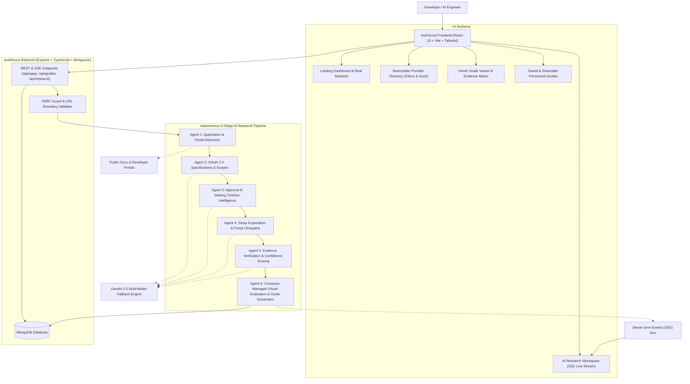

# AUTHSCOUT
### OAuth Integration Intelligence for AI Builders
> *"From integration idea to OAuth-ready application."*

---

## 1. Project Overview

**AuthScout** is a specialized developer intelligence platform and autonomous AI research agent designed for engineers building AI agents and workflow automations. 

When developers build agentic tools that interact with third-party software (such as Google Workspace, Slack, GitHub, Notion, Discord, Linear, or Airtable), OAuth integration requirements are often fragmented, poorly documented, and laden with hidden security verification hurdles (such as Google CASA Tier 2/3 audits, domain ownership verification, or workspace administrator restrictions).

AuthScout solves this by providing:
1. **Curated & Verified OAuth Intelligence Profiles**: Detailed guides covering exact endpoints, PKCE requirements, token rotation lifecycles, and scope classifications.
2. **Clear Separation of Time & Effort**: Distinctly measuring active developer coding hours versus external provider approval waiting periods (never conflating the two).
3. **Composio Managed OAuth Intelligence**: Automatic recommendation on whether developers can bypass weeks of verification and credential maintenance by leveraging Composio Managed OAuth.
4. **Autonomous AI Research Agent Pipeline**: An orchestrated 6-stage investigation engine that navigates official developer portals for unfamiliar applications, extracts endpoints, checks approval barriers, verifies claims, and produces structured, shareable integration guides.
5. **Evidence & Trust System**: Strict verification labels (`VERIFIED`, `INFERRED`, `UNVERIFIED`, `BLOCKED`) with direct citations to authoritative documentation.
6. **Persistent & Shareable Guides**: Permanent public URLs for sharing research across teams without re-executing LLM queries.

---

## 2. Architecture & Multi-Agent Research Pipeline



---

## 3. Technology Stack

- **Frontend**:
  - React 18, TypeScript, Vite
  - Tailwind CSS (Deep charcoal developer palette with indigo & emerald accents)
  - Lucide React (Crisp technical iconography)
  - React Router v6 (Client-side routing with clean permalinks)
- **Backend**:
  - Node.js (v20+ LTS), Express, TypeScript
  - Mongoose (MongoDB ODM with strict indexes and schema validation)
  - Axios & Cheerio (Safe documentation discovery, parsing, and link extraction)
  - Server-Sent Events (SSE) with internal real-time event bus
- **AI & Research Orchestration**:
  - Google Gemini API (`@google/generative-ai`)
  - Multi-model fallback sequence: `gemini-2.5-flash` → `gemini-2.5-pro` → `gemini-flash-latest` → `gemini-2.5-flash-lite`
  - Automated exponential backoff retry handler for resilient execution under upstream API load
- **Database**:
  - MongoDB (supports local MongoDB instance `mongodb://127.0.0.1:27017/authscout` or MongoDB Atlas via `MONGODB_URI`)

---

## 4. Curated Applications Directory

AuthScout includes 6 pre-researched, deeply verified core providers illustrating diverse OAuth integration challenges:

| Provider | Complexity | Active Dev Time | Approval Waiting Time | Composio Managed Auth | Key Challenge / Distinguishing Factor |
|---|---|---|---|---|---|
| **Google** | Difficult | 45–90 min | 3–21 days | **Available** | Restricted scopes (Gmail, Drive) trigger mandatory CASA Tier 2/3 third-party security audits costing $1,500–$15,000+. |
| **Slack** | Medium | 20–45 min | 0 days (Internal) / 2–4 wks (Directory) | **Available** | Bot Scopes vs User Scopes separation; Workspace-level installation and token rotation policies. |
| **GitHub** | Easy | 10–20 min | 0 days | **Available** | Instantaneous registration; Organization-level third-party access restrictions. |
| **Notion** | Medium | 20–35 min | 0 days | **Available** | Token exchange requires HTTP Basic Auth header; End-users must explicitly share individual pages with the integration. |
| **Discord** | Easy | 15–30 min | 0 days (Initial) / 5–10 days (100+ Guilds) | **Available** | Bot bitwise permissions mask calculation; Identity verification required upon reaching 100 guilds. |
| **Linear** | Easy | 10–20 min | 0 days | **Available** | OAuth 2.0 with PKCE (S256) support; Granular actor scopes (`actor=application` vs `actor=user`). |

---

## 5. Composio Managed OAuth vs. Custom OAuth

One of AuthScout's core product differentiators is evaluating whether an integration can use **Composio Managed OAuth**:

```
+-----------------------------------+-----------------------------------+
| Composio Managed OAuth            | Custom OAuth Application          |
+-----------------------------------+-----------------------------------+
| • Zero client registration needed | • Manual registration in console  |
| • Pre-verified enterprise creds   | • 3-21 day review & CASA audits   |
| • Automated token refresh & crypt | • Developer implements scheduling |
| • Instant end-user connect link   | • Developer builds callback auth  |
| • Ideal for AI builders & MVPs    | • Required for custom branding    |
+-----------------------------------+-----------------------------------+
```

### Recommendation Logic
- **Managed Path Recommended**: When Composio provides pre-verified tools (e.g. Google Workspace, Slack, GitHub, Notion, Discord, Linear, Airtable), saving the developer from weeks of compliance delays, privacy policy video recording, and token refresh logic.
- **Custom Path Recommended**: When specialized white-label branding in the provider's consent screen is an absolute business requirement, or when private internal webhooks are required.

---

## 6. Evidence & Trust Verification System

Every technical claim in AuthScout is tagged with a transparent evidence status:
- **`VERIFIED`**: Directly confirmed by official documentation excerpts or successful API contract execution.
- **`INFERRED`**: Derived logically from public platform standards (e.g. standard RFC 7636 PKCE support for web clients).
- **`UNVERIFIED`**: Provider documentation did not explicitly state the parameter or policy.
- **`BLOCKED`**: The agent encountered an external restriction or inaccessible portal stage.

### Sample Official Source Evidence Matrix

| Claim | Provider | Official Documentation Source | Evidence Status | Verified Excerpt |
|---|---|---|---|---|
| Redirect URIs must enforce HTTPS except for localhost | Google | [Google Identity OAuth 2.0](https://developers.google.com/identity/protocols/oauth2/web-server#uri-validation) | `VERIFIED` | *"Authorized redirect URIs must use HTTPS, not HTTP, with the exception of localhost URLs."* |
| Restricted scopes trigger CASA security assessment | Google | [App Defense Alliance CASA Tier](https://appdefensealliance.dev/casa/tier-requirements) | `VERIFIED` | *"Applications requesting restricted Google scopes must obtain CASA Tier 2 or Tier 3 assessment through an approved third-party laboratory."* |
| Bot tokens do not expire by default | Slack | [Slack API Token Rotation](https://api.slack.com/authentication/rotation) | `VERIFIED` | *"By default, Slack access tokens do not expire. You can optionally enable token rotation to receive 12-hour expiring access tokens."* |
| Token endpoint requires Accept header for JSON | GitHub | [GitHub Docs Authorizing OAuth](https://docs.github.com/en/apps/oauth-apps/building-oauth-apps/authorizing-oauth-apps) | `VERIFIED` | *"By default, the response takes the following form: access_token=gho_... To receive JSON, send Accept: application/json."* |
| Token endpoint requires HTTP Basic Auth header | Notion | [Notion Authorization Guide](https://developers.notion.com/docs/authorization) | `VERIFIED` | *"Set the Authorization header to Basic <base64 encoded client_id:client_secret>."* |
| Proof Key for Code Exchange (PKCE) with S256 supported | Linear | [Linear Developer Authentication](https://developers.linear.app/docs/graphql/working-with-the-graphql-api/authentication) | `VERIFIED` | *"Linear supports PKCE for enhanced security during the authorization code grant flow."* |

---

## 7. AI Research Agent Live Validation: Airtable Case Study

To validate the autonomous research pipeline on an unfamiliar application, the agent was tasked with investigating **Airtable** (`https://airtable.com`):

1. **Stage 1 — Application Discovery**:
   - Navigated `https://airtable.com`, `https://airtable.com/developers`, and `https://airtable.com/api`.
   - Extracted 3 live documentation endpoints and confirmed OAuth 2.0 support.
2. **Stage 2 — OAuth Research**:
   - Extracted Authorization endpoint (`https://airtable.com/oauth2/v1/authorize`) and Token endpoint (`https://airtable.com/oauth2/v1/token`).
   - Identified PKCE requirement (Airtable enforces PKCE with `code_challenge_method=S256` for OAuth integrations).
   - Extracted granular scopes: `data.records:read`, `data.records:write`, `schema.bases:read`.
3. **Stage 3 — Approval Intelligence**:
   - Verified that private integrations require **0 days of waiting** (instant distribution).
   - Identified that submitting to the Airtable Marketplace requires review.
4. **Stage 4 — Setup Exploration**:
   - Mapped step-by-step developer portal instructions: Navigate to Airtable Builder Hub → Register OAuth Integration → Configure Redirect URI.
   - Identified blockers: Redirect URI mismatch, PKCE code verifier hashing errors.
5. **Stage 5 — Evidence Verification**:
   - Scored 92% research confidence with direct citations to `airtable.com/developers`.
6. **Stage 6 — Composio Intelligence & Guide Synthesis**:
   - Identified verified Composio support (`composio-airtable`) and recommended Managed OAuth.
   - Generated permanent shareable guide at: `/guides/share/airtable-mw10fldu`.

---

## 8. Installation & Local Development Instructions

### Prerequisites
- Node.js v20.x or higher
- MongoDB running locally on port 27017, or a MongoDB Atlas URI
- Gemini API key (`GEMINI_API_KEY`)

### Setup Steps

1. **Clone the repository and install dependencies**:
   ```bash
   git clone <repo_url>
   cd "Product Intern"
   
   # Install server dependencies
   cd server && npm install
   
   # Install client dependencies
   cd ../client && npm install
   cd ..
   ```

2. **Configure Environment Variables**:
   Copy `.env.example` to `server/.env`:
   ```bash
   cp .env.example server/.env
   ```
   Ensure `GEMINI_API_KEY` is populated.

3. **Build the Application**:
   ```bash
   # Build client bundle
   npm --prefix client run build
   
   # Build server TypeScript
   npm --prefix server run build
   ```

4. **Run the Application**:
   ```bash
   # Run the production-ready server (serves both API & Frontend on http://localhost:5000)
   node server/dist/index.js
   
   # Or run concurrently in developer watch mode with hot reload:
   npm run dev
   ```

5. **Open in Browser**:
   - Access the platform at: **`http://localhost:5000`** (or `http://localhost:5173` if running Vite dev server).

---

## 9. API Specification

| Method | Endpoint | Description |
|---|---|---|
| `GET` | `/api/health` | Service health status and uptime |
| `GET` | `/api/stats` | Real platform statistics computed directly from MongoDB |
| `GET` | `/api/apps` | Searchable directory with query, complexity, and managed status filters |
| `GET` | `/api/apps/:slug` | Specific provider profile |
| `GET` | `/api/guides` | List of all saved integration guides |
| `GET` | `/api/guides/:slug` | Full OAuth guide by provider slug |
| `GET` | `/api/guides/share/:shareId` | Permanent public shareable guide endpoint |
| `POST` | `/api/research` | Initiate autonomous research job for unfamiliar app |
| `GET` | `/api/research/:jobId` | Poll research job status and progress events |
| `GET` | `/api/research/:jobId/stream` | Server-Sent Events (SSE) live execution progress stream |

---

## 10. Security & Responsible Agent Engineering

1. **SSRF Guard**: All user-supplied URLs are strictly validated to block loopback addresses (`127.0.0.1`, `localhost`), private RFC 1918 subnets (`10.x`, `192.168.x`, `172.16-31.x`), AWS/GCP cloud metadata endpoints (`169.254.169.254`), and non-HTTP protocols.
2. **Credential Safety**: No API keys, OAuth client secrets, or private database credentials are logged, exposed to the frontend, or committed to git.
3. **Bounded Automation**: The research agent never submits fabricated registration forms or attempts to bypass provider authentication barriers. It clearly delineates automated research from developer legal and business account responsibilities.

---

## 11. Known Limitations & Future Roadmap

- **Dynamic Headless Evaluation**: Public browser DOM exploration is currently optimized for static and SSR documentation pages; expanding Playwright headless execution to complex single-page apps behind heavy JavaScript hydration will further enhance automated form discovery.
- **Automated Scope Diffing**: Future iterations could monitor provider changelogs (e.g. Google API deprecation notices) and alert developers when permissions change.
- **Export Formats**: PDF / Markdown export is functional via browser print styles; direct OpenAPI / Postman collection export would make testing even faster.
